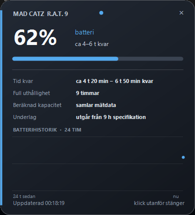

<p align="center">
  
</p>

<h1 align="center">Mad Catz R.A.T. 9 Battery Monitor</h1>

<p align="center">
  A lightweight Windows tray monitor for the wireless Mad Catz R.A.T. 9.
</p>

<p align="center">
  
  
  
  
</p>

<p align="center">
  <a href="https://github.com/GiddyGorilla/madcatz-rat9-battery-monitor/releases/latest"><strong>Download the latest release</strong></a>
</p>

The Mad Catz R.A.T. 9 does not expose a standard Windows battery device.
This project reads the battery through the installed Mad Catz SmartTechnology
driver and turns it into a compact, live system-tray experience.



## Why this exists

The R.A.T. 9 is still a distinctive and repairable wireless mouse, but its
original software is old and does not provide a modern battery indicator.
This project keeps the useful part of that driver and adds:

- A live percentage directly in the Windows notification area.
- An approximate remaining-time range instead of a misleadingly exact number.
- A 24-hour battery history chart.
- Measured long-term runtime and capacity estimates.
- Alerts at 20%, 10%, and 5%, when the battery is full, or if the mouse disconnects.
- Automatic recovery if the aging vendor driver stalls during a battery swap.
- A detail popup that closes when you click elsewhere.
- Optional pinning for users who prefer a permanent desktop widget.

All processing stays on the local computer. There is no account, analytics,
telemetry, cloud service, or bundled proprietary Mad Catz code.

## Quick start

### Requirements

1. Windows 10 or Windows 11.
2. .NET Framework 4.8.
3. Mad Catz SmartTechnology 7.0.45.2 or a compatible R.A.T. 9 driver.
4. The R.A.T. 9 receiver connected and the mouse paired.

### Run it

1. Download the newest ZIP from
   [Releases](https://github.com/GiddyGorilla/madcatz-rat9-battery-monitor/releases/latest).
2. Extract it to a permanent folder.
3. Run `RAT9BatteryTray.exe`.
4. Left-click the percentage icon in the system tray.

Windows may initially place the icon under the notification-area chevron.
Enable it under **Settings → Personalization → Taskbar → Other system tray
icons**, or drag it onto the taskbar.

Right-click the tray icon to:

- Open the battery panel.
- Pin the panel to the desktop.
- Start the monitor with Windows.
- Refresh immediately.
- Exit.

See [Quick start](docs/QUICKSTART.txt) and
[Troubleshooting](docs/TROUBLESHOOTING.md) for more detail.

## What the numbers mean

The battery driver returns values from 1 to 200:

- `1–100`: discharging percentage.
- `101–200`: charging; subtract 100 to get the current percentage.
- `201`: no measurement is currently available.

The initial time range uses Mad Catz's published maximum of roughly 9 hours
of continuous gaming. As the app collects real discharge data, it adjusts the
estimate for the current battery, workload, and age. The UI deliberately shows
a range and labels calibrated estimates instead of presenting a guess as a
precise countdown.

Read [How it works](docs/HOW_IT_WORKS.md) for protocol and estimator details.

## Compatibility

| Item | Supported |
| --- | --- |
| Mad Catz R.A.T. 9 | Yes |
| Windows 10 / 11, x64 | Yes |
| SmartTechnology 7.x | Yes |
| Standard Windows battery API | Not used; the mouse does not expose one |
| Other Mad Catz mice | Not verified |

The project relies on the vendor API shipped with SmartTechnology. The
proprietary DLL is **not** redistributed by this repository.

## Build from source

You need Windows and Visual Studio Build Tools with the Roslyn C# compiler.
The build does not require SmartTechnology to be installed.

```powershell
pwsh -ExecutionPolicy Bypass -File .\build.ps1
```

Outputs are written to `dist/`:

- `RAT9BatteryTray.exe` — tray application.
- `RAT9BatteryProbe.exe` — console diagnostic.
- `MadCatz-RAT9-Battery-Monitor-v1.0.1-win.zip` — release bundle.
- `SHA256SUMS.txt` — checksums.

The GitHub Actions workflow builds the project on every push and pull request.

## Privacy and security

- No network requests from the application.
- No telemetry or crash upload.
- History is stored only in
  `%LOCALAPPDATA%\MadCatzRat9BatteryTray\history-v1.txt`.
- Diagnostics are written locally only after an application error.
- The app runs as the current user and does not request elevation.

## Contributing

Bug reports and compatibility findings are welcome. Please include the Windows
version, SmartTechnology version, and relevant entries from
[Troubleshooting](docs/TROUBLESHOOTING.md). See
[CONTRIBUTING.md](CONTRIBUTING.md).

## License and trademarks

The source code is available under the [MIT License](LICENSE).

Mad Catz, R.A.T., and SmartTechnology are trademarks of their respective
owners. This is an independent community project and is not affiliated with or
endorsed by Mad Catz.
